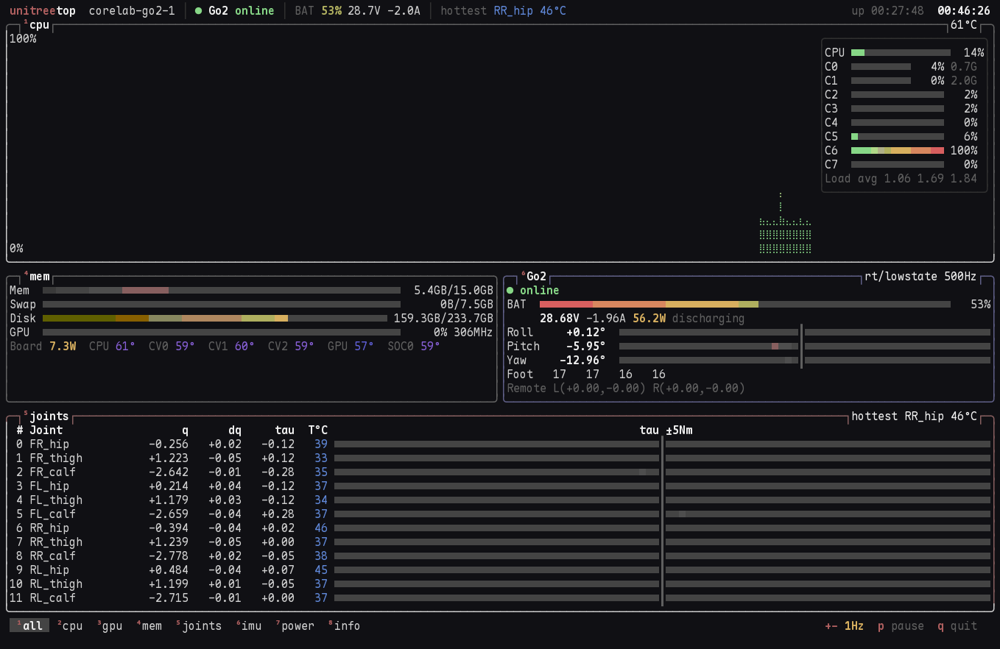

# unitreetop

**English** | [中文](README.zh-CN.md)

[](LICENSE)


A terminal console for Unitree robots: a [jtop](https://github.com/rbonghi/jetson_stats)-style monitor with a
[btop](https://github.com/aristocratos/btop) look, plus a keyboard control panel.

- **Monitor.** Host metrics (CPU, GPU, memory, temperatures, power) next to live robot state over
  [`unitree_sdk2py`](https://github.com/unitreerobotics/unitree_sdk2_python) (CycloneDDS): joints, battery/BMS, IMU,
  foot force, wireless remote, sport state and all DDS topics.
- **Control.** Page ⁹ drives the robot from the keyboard through the high-level sport/loco API. It sends nothing until
  you arm it, and `--no-control` disables it completely.




## Supported robots

| Model | DDS family | Joints | Control API | Status |
|---|---|---|---|---|
| Go2 | `unitree_go` | 12 | `SportClient` | ✅ monitor tested on a real robot |
| Go2-W, B2 / B2-W, H1 | `unitree_go` | 16 / 12 / 16, 19 | `SportClient` / `LocoClient` | from SDK definitions |
| G1 (23/29 DoF), H1-2 | `unitree_hg` | 23 / 29, 27 | `LocoClient` (H1-2: monitor only) | tested on simulated DDS data |

Control has only been tested against a fake RPC service (`tools/fake_robot.py`), **not yet on a real robot**.
Go2 and B2 publish identical lowstate layouts, so pass `-r b2` for a B2.

## Quick start

```bash
git clone --recurse-submodules git@github.com:SimonKennethRobo/unitreetop.git ~/Apps/unitreetop
ln -s ~/Apps/unitreetop/bin/unitreetop ~/.local/bin/unitreetop
unitreetop                          # on the robot's Jetson
python3 -m unitreetop --demo -r g1  # no robot needed
```

Requirements: Python ≥ 3.8, `psutil`, `cyclonedds==0.10.x`. The Unitree SDK is bundled as a submodule
(`git submodule update --init` if you forgot `--recurse-submodules`; `UNITREETOP_SDK=system` uses the installed one).
Optional: `jetson-stats` (Jetson GPU/power), `nvidia-ml-py` (desktop GPUs). Or install with
`pip3 install -e .` (`".[jetson]"` adds jetson-stats).

## Usage

```bash
unitreetop -i eth1               # explicit NIC (default: the one with a 192.168.123.x address)
unitreetop -i enp3s0 -r g1       # external PC cabled to a G1, model forced
unitreetop -p joints             # open a page directly
unitreetop --json --wait 3       # one JSON snapshot and exit
unitreetop -d 1 -i lo            # unitree_mujoco simulator
```

Main options (`unitreetop -h` lists all):

| Option | Description |
|---|---|
| `-i`, `-d` | NIC and DDS domain (robot: 0, unitree_mujoco: 1); env `UNITREETOP_IFACE` / `UNITREETOP_DOMAIN` |
| `-r` | `auto` `go2` `go2w` `b2` `b2w` `h1` `g1` `h1_2` |
| `-p` | start page: `all cpu gpu mem joints imu power info ctrl` |
| `--no-robot` / `--demo` | host only / synthetic robot data |
| `--no-control` | monitor only, no command is ever sent |
| `--vel-step`, `--max-vx/vy/wz` | teleop step and velocity caps |

Keys: `1`–`9` / `←` `→` / mouse switch page, `+` `-` refresh rate, `p` pause, `q` quit; `↑` `↓` select a joint (JOINTS)
or scroll topics (INFO), `s` sorts processes (CPU), `a` shows empty motor slots (JOINTS).

Pages: ¹ all, ² cpu, ³ gpu, ⁴ mem, ⁵ joints, ⁶ imu, ⁷ power, ⁸ info, ⁹ ctrl. JOINTS/IMU refresh at 50 Hz by default
(about 48% of one Orin NX core), the rest at 1 Hz (about 8%).

## Keyboard control

> ⚠️ This moves a real robot. Clear the area, keep the official remote (or another e-stop) at hand, and keep humanoids
> on a gantry until you know how they behave.

Open page ⁹, check that the robot is **online**, press **Enter** to arm. Velocity keys *adjust* a locked velocity, as in
`go2_keyboard_ctrl`: the first press from zero jumps to 0.3 m/s (`vx`/`vy`) or 0.5 rad/s (`wz`), each further press adds
one `--vel-step`; the opposite key slows down through zero. Speeds are capped per model, and a non-zero velocity is sent
at 10 Hz.

| Key | Command |
|---|---|
| `W` `S` / `A` `D` / `Q` `E` | `vx` / `vy` / `wz` ± one step |
| `Space` | clear velocity (StopMove) |
| `Z` / `X` | sit or lie down / stand up (also leaves damping) |
| `P` | damp: motors go limp, a standing robot will fall |
| `Esc` / `Enter` | disarm |

**Safety.** Nothing is sent until armed, and arming is refused while the robot is offline. The panel disarms and stops
the robot on `Esc`, leaving the page, quit, Ctrl-C, SIGHUP/SIGTERM, or when the robot goes offline or stale. Held
posture keys fire once, velocity keys stay locked after `P` until `X` succeeds, and a failed Move clears the velocity.
The sport service must be running; if `rt/sportmodestate` is missing, commands will time out.

## JSON and Python API

```python
from unitreetop import UnitreeTop

with UnitreeTop(interface="eth1") as ut:       # same options as the CLI
    while ut.ok():
        r = ut.robot
        print(ut.cpu["total"], r.battery.soc, r.imu.rpy)
```

`--json` prints `system`, `gpu` and `robot` sections; `ut.history.get(key)` returns the ring buffers behind the graphs.
See [docs/architecture.md](docs/architecture.md) for how it works and how to add robots or pages.

## Troubleshooting

| Symptom | Fix |
|---|---|
| stuck at `waiting for rt/lowstate` | pass `-i` with the NIC that reaches the robot (192.168.123.0/24), check `-d`, and on an external PC the multicast firewall |
| `CycloneDDS library could not be located` | build CycloneDDS 0.10.x and set `CYCLONEDDS_HOME` |
| `No module named unitree_sdk2py` | `git submodule update --init` |
| wrong model | force it with `-r` |
| no GPU backend | Jetson: start `jtop.service`; desktop: make sure `nvidia-smi` works |
| garbled colors/symbols | `TERM=xterm-256color` and a Unicode monospace font |

G1/H1-2 BMS units are inferred from the SDK IDL and not yet verified on a real robot. Control uses the high-level API
only (no joint commands), and one robot (one DDS domain and NIC) is supported per instance.

## Development

Test without a robot, on a domain other than the robot's so commands can never reach real hardware:

```bash
python3 tools/fake_robot.py --family go -d 7 -i lo &   # fake Go2 (--family hg for a G1)
unitreetop -d 7 -i lo -p ctrl
```

## License and credits

[MIT](LICENSE); the bundled unitree_sdk2_python keeps its BSD-3-Clause license. Thanks to
[jetson_stats](https://github.com/rbonghi/jetson_stats), [btop](https://github.com/aristocratos/btop) and
[unitree_sdk2_python](https://github.com/unitreerobotics/unitree_sdk2_python). Not affiliated with Unitree Robotics or NVIDIA.
