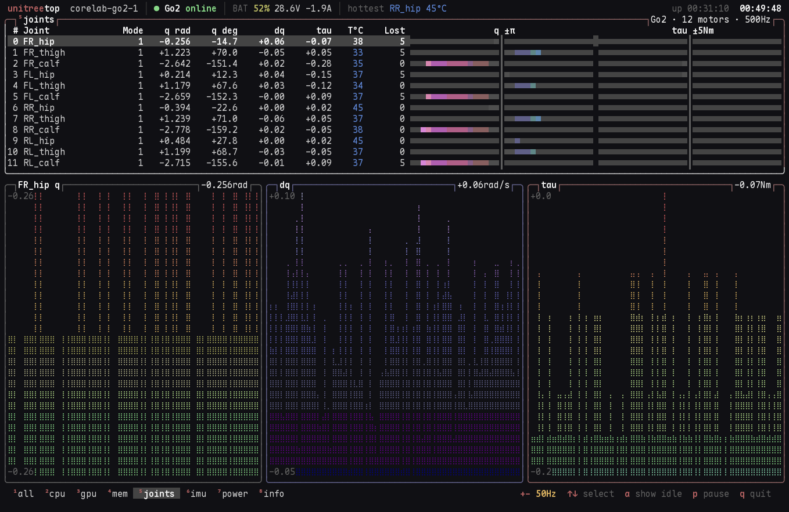

# unitreetop

仿 [jetson_stats / jtop](https://github.com/rbonghi/jetson_stats) 的终端监控工具，面向 Unitree 机器人
（Go2 / Go2-W / B2 / B2-W / H1 / G1 / H1-2）。除了 CPU、GPU、内存、温度、功耗这些常规指标，还通过
`unitree_sdk2py`（CycloneDDS）实时显示机器人状态：关节、电池 BMS、IMU、足端力、遥控器、运动状态。

界面风格参照 [btop](https://github.com/aristocratos/btop)：圆角面板、`¹cpu` 式上标快捷键、`■` 渐变条、braille 点阵曲线，配色使用 btop 默认主题。
下图为 Go2 真机画面（终端截图转 PNG）：




## 安装

依赖：Python ≥ 3.8、`psutil`、`unitree_sdk2py`（需要 CycloneDDS 0.10.x）。在机器人自带的 Jetson 上这些通常都已装好。

```bash
# unitree_sdk2py 不在 PyPI，按官方说明安装：https://github.com/unitreerobotics/unitree_sdk2_python
# 方式一：直接运行脚本（推荐，改源码立即生效）
ln -s "$PWD/bin/unitreetop" ~/.local/bin/unitreetop
ln -s "$PWD/bin/unitreetop" ~/.local/bin/untop

# 方式二：pip 安装
pip3 install -e .            # 提供 unitreetop / untop 两个命令
pip3 install -e .[jetson]    # 可选：jetson-stats，Jetson 上的 GPU、功耗轨、风扇、nvpmodel 信息更完整
```

## 使用

```bash
unitreetop                       # 自动选用 192.168.123.x（机器人内网）所在的网卡
unitreetop -i eth1               # 也可以手动指定网卡
unitreetop -i enp3s0 -r g1       # 外部 PC 网线直连 G1，并指定型号
unitreetop --demo -r h1_2        # 无需机器人和 DDS 的演示数据
unitreetop -i eth1 --json        # 输出一次 JSON 快照后退出（方便脚本或日志）
unitreetop -d 1 -i lo            # 连接 unitree_mujoco 仿真（domain 1）
```

| 参数 | 说明 |
|---|---|
| `-i/--interface` | 连接机器人的网卡；不填则自动选 IP 为 192.168.123.x 的网卡，再找不到交给 CycloneDDS |
| `-d/--domain` | DDS domain（真机 0，unitree_mujoco 默认 1） |
| `-r/--robot` | `auto`（默认）/`go2`/`go2w`/`b2`/`b2w`/`h1`/`g1`/`h1_2`，决定关节命名 |
| `--lowstate-topic` | 默认 `rt/lowstate`；可改为 `rt/lf/lowstate`（低频镜像） |
| `--gpu` | `auto`/`jtop`/`tegra`/`nvidia`/`none` |
| `-p/--page` | 启动页面：`all cpu gpu mem joints imu power info` |
| `--no-robot` | 只看主机 |

终端需要支持 256 色（`TERM=xterm-256color` 等，现代终端和 tmux 基本都满足），否则自动降级为 8 色。

按键：`1`–`8` 或 `←/→/Tab` 切换页面（也可以鼠标点击底部标签），`+`/`-` 调节当前页刷新率，`p` 暂停，`q` 退出；JOINTS 页 `↑↓` 选关节（下方曲线显示该关节 q/dq/tau 的历史），`a` 显示未使用的电机槽位；CPU 页 `s` 切换排序；INFO 页 `↑↓` 滚动话题列表。

### 刷新率

每个页面的刷新率独立设置，切换页面后保留各自的值；底栏黄色的 `+/-:NHz` 显示当前值，终端跟不上时会附上实际帧率 `(~N)`。

| 页面 | 默认 | 步长 | 范围 |
|---|---|---|---|
| JOINTS、IMU | 50 Hz | 10 Hz | 10–200 Hz |
| ALL、POWER 及其余页面 | 1 Hz | 1 Hz | 1–10 Hz |

机器人数据快照频率跟随当前页面（不低于 `--robot-hz`，默认 20 Hz），所以 50 Hz 页面显示的是 50 Hz 的新数据，曲线窗口约 4.8 s（240 个点）。
在 Go2 的 Orin NX 上实测：1 Hz 页面约占单核 8%，50 Hz 页面约占 48%（每帧绘制约 4 ms，开销与刷新率大致成正比）。

## 页面

| 页 | 内容 |
|---|---|
| 1 ALL | 各核 CPU、内存/交换/磁盘、GPU、板载温度和功耗；机器人型号/连接/频率、电池、RPY、足端力、遥控器，以及全部关节表 |
| 2 CPU | 总 CPU 曲线、各核负载与频率、进程表 |
| 3 GPU | GPU 负载曲线与频率；温度、Jetson 功耗轨（VDD_IN 等）、nvpmodel/jetson_clocks、CUDA/TensorRT 版本、各硬件引擎 |
| 4 MEM | 内存曲线、网卡 IP 与实时收发速率（机器人网卡加粗） |
| 5 JOINTS | 每个关节的 mode、q（rad/°）、dq、tau、温度、丢包/错误码（hg 系列另有第二温度和电压），q/tau 双向条形图，选中关节的历史曲线 |
| 6 IMU | RPY、四元数、角速度、加速度及其模长、IMU 温度，roll/pitch/gyro-z 曲线；sportmodestate（若有发布）、足端力、遥控器摇杆和按键 |
| 7 POWER | SOC、电压、电流、功率、循环次数、SOH、BMS 温度、各节电芯电压及压差；电池功率/电压曲线、计算板功耗曲线、主板 NTC 和风扇 |
| 8 INFO | 主机/板卡/软件版本；机器人型号、DDS 家族、固件版本、各订阅话题实际频率；DDS 发现到的全部话题及类型 |

## 作为库使用（接口风格同 `jtop`）

```python
from unitreetop import UnitreeTop

with UnitreeTop(interface="eth1") as ut:
    while ut.ok():
        r = ut.robot
        print(ut.cpu["total"], r.battery.soc, r.imu.rpy, [m.temp for m in r.active_motors])
```

## 实现要点

* **自动识别**：用 DDS 内置发现话题（`DCPSPublication`）读取网络上所有话题和类型名。`rt/lowstate` 的类型决定消息家族：
  `unitree_go::LowState_` 对应 Go2/B2/H1，`unitree_hg::LowState_` 对应 G1/H1-2。电池（`unitree_hg::BmsState_`）、
  主板（`MainBoardState_`）和运动状态（`SportModeState_`）按类型订阅，不写死话题名；运动模式中途开启时也会自动补订阅。
  型号根据有数据的电机槽位推断（12→Go2，16→Go2-W，≥17→H1；hg：H1-2 / G1）。
* **低开销**：lowstate 为 500 Hz。读者使用 `KeepLast(1)`，监听回调只计数（用于显示 Hz），只在 20 Hz 快照时反序列化最新样本。
  在 Go2 的 Orin NX 上，机器人数据接收约占单核 5%；如果每条消息都在 Python 中反序列化，约占 70%。
  进程表扫描较贵（约 0.1 CPU·s/次），只在 CPU 页打开时每 2 s 执行一次。
* **GPU/板卡后端**：Jetson 上优先使用 jtop（需要 `jtop.service`），否则读 tegra sysfs；桌面 GPU 用 NVML 或 `nvidia-smi`。
* 每 2 s 强制全屏重绘：机器人 Jetson 上的内核/syslog 广播（wall）会直接写到终端，打乱 curses 画面。

## 已知限制

* Go2 与 B2（Go2-W 与 B2-W）的 lowstate 结构相同，无法区分，B2 请加 `-r b2`。
* G1/H1-2 的 BMS 字段单位（电压为 mV、电流为 mA）按 SDK IDL 推断，尚未在真机上验证；没有 BMS 话题时，电压用电机母线电压估算。
* 只读监控，不发布任何命令。

## 测试工具

`tools/fake_robot.py` 可在本机发布模拟的 go/hg lowstate、BMS 和运动状态，用来在没有机器人时测试 DDS 路径：

```bash
python3 tools/fake_robot.py --family hg -d 1 -i lo &
unitreetop -d 1 -i lo
```
