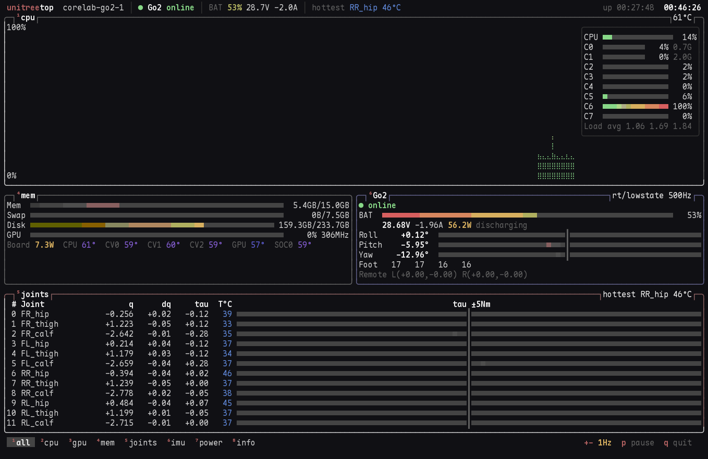
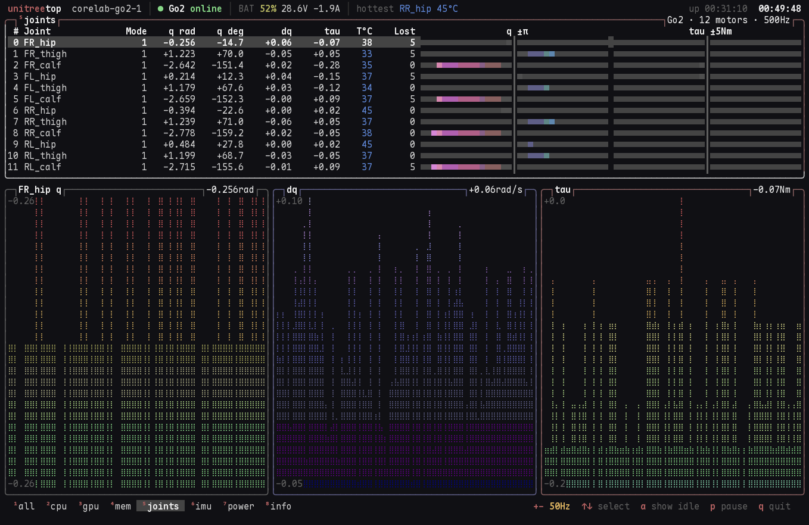

# unitreetop

[English](README.md) | **中文**

[](LICENSE)


宇树机器人的终端监控与控制台：结合 [jtop](https://github.com/rbonghi/jetson_stats) 风格的硬件监控与 [btop](https://github.com/aristocratos/btop) 终端UI，内置键盘控制面板。

- **全维度监控**：除主机指标（CPU、GPU、内存、温度、功耗）外，通过 [`unitree_sdk2py`](https://github.com/unitreerobotics/unitree_sdk2_python)（CycloneDDS）实时呈现机器人状态：关节、电池/BMS、IMU、足端力、遥控器、运动状态及全网 DDS 话题。
- **高层键盘控制**：第 ⁹ 页支持通过高层 Sport/Loco API 遥控机器人。




---

## 支持型号

| 型号                         | DDS 族         | 关节数  | 控制 API        |
| :--------------------------- | :------------- | :------ | :-------------- |
| **Go2**                | `unitree_go` | 12      | `SportClient` |
| **Go2-W**              | `unitree_go` | 16      | `SportClient` |
| **B2 / B2-W**          | `unitree_go` | 12 / 16 | `SportClient` |
| **H1**                 | `unitree_go` | 19      | `LocoClient`  |
| **G1（23/29 自由度）** | `unitree_hg` | 23 / 29 | `LocoClient`  |
| **H1-2**               | `unitree_hg` | 27      | 仅监控          |


## 安装与启动

### 1. 环境依赖

- **必选**：Python >= 3.8、`psutil`、`cyclonedds==0.10.x`（宇树 Jetson 主板通常已预装）。
- **内置 SDK**：`unitree_sdk2_python` 已作为 Git 子模块打包；设置 `UNITREETOP_SDK=system` 可切换为系统已安装版本。
- **可选**：`jetson-stats`（Jetson GPU 与功耗详情）、`nvidia-ml-py`（桌面级 NVIDIA 显卡）。

### 2. 快速安装

```bash
git clone --recurse-submodules [https://github.com/SimonKennethRobo/unitreetop.git](https://github.com/SimonKennethRobo/unitreetop.git) ~/Apps/unitreetop
ln -s ~/Apps/unitreetop/bin/unitreetop ~/.local/bin/unitreetop

unitreetop                          # 在机器人 Jetson 上直接运行
python3 -m unitreetop --demo -r g1  # 无真机时使用模拟数据体验
```

*(若克隆时遗漏子模块，运行 `git submodule update --init` 补全；也支持通过 `pip3 install -e .` 或 `pip3 install -e ".[jetson]"` 安装。)*

## 使用指南

### 常用命令

```bash
unitreetop -i eth1               # 指定网卡（默认自动选择 192.168.123.x 所在网卡）
unitreetop -i enp3s0 -r g1       # 外接 PC 连接 G1，强制指定型号
unitreetop -p joints             # 启动时直接进入指定页面
unitreetop --json --wait 3       # 采集 3 秒后输出一次 JSON 快照并退出
unitreetop -d 1 -i lo            # 连接 unitree_mujoco 仿真器
```

### 命令行参数

| 选项                               | 环境变量              | 默认值   | 说明                                                                                   |
| :--------------------------------- | :-------------------- | :------- | :------------------------------------------------------------------------------------- |
| `-i`, `--interface`            | `UNITREETOP_IFACE`  | `auto` | 连接机器人的网络接口                                                                   |
| `-d`, `--domain`               | `UNITREETOP_DOMAIN` | `0`    | DDS Domain ID（真机为 `0`，MuJoCo 仿真为 `1`）                                     |
| `-r`, `--robot`                | -                     | `auto` | 强制型号：`go2` `go2w` `b2` `b2w` `h1` `g1` `h1_2`                       |
| `-p`, `--page`                 | -                     | `all`  | 起始页：`all` `cpu` `gpu` `mem` `joints` `imu` `power` `info` `ctrl` |
| `--no-robot` / `--demo`        | -                     | -        | 仅监控主机硬件 / 使用合成机器人数据                                                    |
| `--no-control`                   | -                     | -        | 纯监控模式，彻底屏蔽控制功能                                                           |
| `--vel-step`、`--max-vx/vy/wz` | -                     | -        | 键盘控制的步长与最大速度限制                                                           |

### 界面与快捷键

- **页面列表**：¹ `all`（总览）、² `cpu`（处理器与进程）、³ `gpu`（显卡与功耗）、⁴ `mem`（内存与网速）、⁵ `joints`（关节详情）、⁶ `imu`（姿态与足端力）、⁷ `power`（电池与电芯）、⁸ `info`（版本与 DDS 话题）、⁹ `ctrl`（键盘控制）。
- **刷新率与开销**：`JOINTS` 与 `IMU` 默认 **50 Hz**（约占 Orin NX 单核 48%），其余页面默认 **1 Hz**（约占 8%）。
- **通用操作**：
  - `1`–`9` / `←` `→` / 鼠标点击顶部菜单：切换页面
  - `+` / `-`：调整当前页面刷新率
  - `p` / `q`：暂停刷新 / 退出程序
- **页面专属**：
  - **JOINTS**：`↑` `↓` 选择关节查看历史曲线；`a` 显示/隐藏空电机槽
  - **CPU**：`s` 切换进程排序方式（CPU / 内存 / PID）
  - **INFO**：`↑` `↓` 滚动 DDS 话题列表

## 键盘控制（第 ⁹ 页）

> ⚠️ **安全警告**：此功能将驱动真实机器人运动！操作前请确保周围无障碍物，随身携带官方遥控器以便随时急停；调试人形机器人时请务必将其悬挂在保护吊架上。

进入第 ⁹ 页确认机器人状态为 **online** 后，按 **Enter** 解锁控制。速度控制逻辑与 `go2_keyboard_ctrl` 一致（采用速度锁定与步进微调）：

- 静止时首次按下方向键，速度直接跃迁至 `0.3 m/s`（`vx`/`vy`）或 `0.5 rad/s`（`wz`），随后每次按键增减一个 `--vel-step`。
- 按下反方向键会先减速过零再反向；速度受型号上限约束，非零速度以 10 Hz 持续下发。

| 按键                                    | 功能                                                           |
| :-------------------------------------- | :------------------------------------------------------------- |
| `W` `S` / `A` `D` / `Q` `E` | 增减 `vx`（前后）/ `vy`（左右）/ `wz`（转向）速度        |
| `Space`                               | 速度归零（`StopMove`）                                       |
| `Z` / `X`                           | 坐下或趴下 / 站起（同时解除阻尼状态）                          |
| `P`                                   | **进入阻尼模式**（电机卸力，站立状态下机器人会直接倒下） |
| `Esc` / `Enter`                     | 立即上锁                                                       |

**内置安全联锁**：

- 未解锁时绝不发包；机器人离线时禁止解锁。
- 触发 `Esc`、切换页面、退出、Ctrl-C、终端断开（`SIGHUP`/`SIGTERM`）或机器人数据超时，系统会自动上锁并停止机器人。
- 长按姿态键仅触发一次；触发阻尼（`P`）后速度键将保持锁定，直到站起（`X`）成功；执行 `Move` 失败时速度自动清零。
- 依赖机器人的 Sport 服务，若未检测到 `rt/sportmodestate` 话题，控制指令将会超时。

## JSON 输出与 Python API

`unitreetop` 提供类似 `jtop` 的上下文管理器接口，方便集成到自定义脚本中：

```python
from unitreetop import UnitreeTop

with UnitreeTop(interface="eth1") as ut:       # 参数与命令行选项一致
    while ut.ok():
        r = ut.robot
        print(f"CPU: {ut.cpu['total']}% | SOC: {r.battery.soc}% | RPY: {r.imu.rpy}")
```

- `--json` 会导出包含 `system`、`gpu`、`robot` 三部分的完整快照。
- `ut.history.get(key)` 可直接读取图表背后的环形缓冲区数据。
- 架构设计及新增机器人/页面扩展指南，请参阅 [docs/architecture.md](docs/architecture.md)。

## 故障排查

| 现象                                        | 解决方法                                                                                                                             |
| :------------------------------------------ | :----------------------------------------------------------------------------------------------------------------------------------- |
| 卡在 `waiting for rt/lowstate`            | 使用 `-i` 显式指定连向机器人的网卡（`192.168.123.0/24` 网段），确认 `-d` 域 ID 一致；外接 PC 需检查防火墙是否拦截了 UDP 组播。 |
| `CycloneDDS library could not be located` | 编译安装 CycloneDDS 0.10.x 并设置环境变量 `CYCLONEDDS_HOME`。                                                                      |
| `No module named unitree_sdk2py`          | 执行 `git submodule update --init` 拉取内置 SDK。                                                                                  |
| 型号识别错误                                | 通过 `-r` 参数强制指定对应型号（如 `-r b2`）。                                                                                   |
| 无 GPU 后端信息                             | Jetson 请启动 `jtop.service`；桌面端请确认 `nvidia-smi` 可正常运行。                                                             |
| 终端颜色或框线字符乱码                      | 设置 `TERM=xterm-256color`，并换用完整支持 Unicode 的等宽字体。                                                                    |

**已知限制**：G1 / H1-2 的 BMS 单位由 SDK IDL 推断，尚未经真机实测；控制模块仅调用高层 API（不涉及底层关节控制）；单实例仅监控一个 DDS Domain 与网卡。

## 开发与本地测试

可使用内置模拟器在不连接真机的情况下测试完整链路（请务必使用与真机不同的 `-d` domain，防止测试指令误发至真机）：

```bash
python3 tools/fake_robot.py --family go -d 7 -i lo &   # 模拟 Go2（模拟 G1 请用 --family hg）
unitreetop -d 7 -i lo -p ctrl
```
